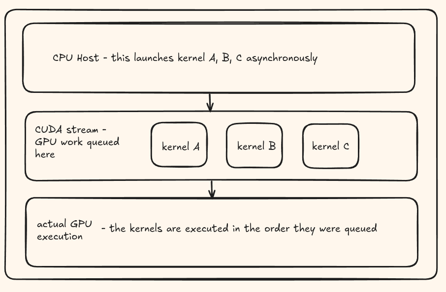
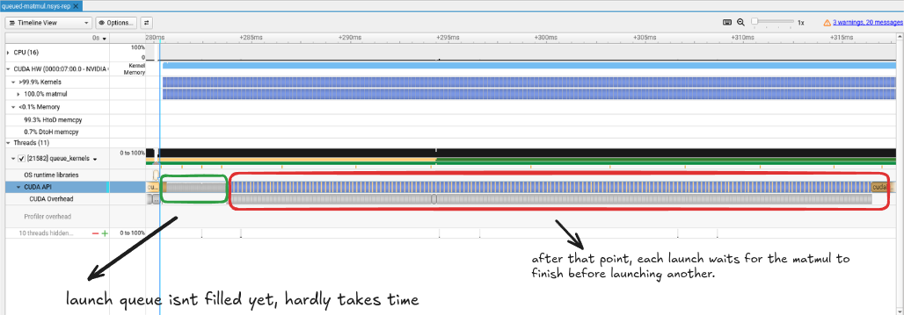

### understanding cuda launch queue and streams

a CUDA stream is an abstraction which allows the programmer to express a sequence of operations. A stream operates like a work-queue into which programs can add operations, such as memory copies or kernel launches, to be executed in order. Operations at the front of the queue for a given stream are executed and then dequeued allowing the next queued operation to come to the front and to be considered for execution. The order of execution of operations in a stream is sequential and the operations are executed in the order they are enqueued into the stream.

Launching a CUDA kernel is normally asynchronous with respect to the CPU where the launch call returns before the kernel necessarily starts or completes. The
kernel can begin executing as soon as its stream ordering requirements and GPU resources allow.



an immediate question i have is, what is the limit for the number of kernels i can queue here? for this i could not find an answer on the internet, so i decided to experiment on my rtx 4060 ti.


a simple 512x512 matmul `queue_kernels.cu` is launched repeatedly in the default stream. my idea was if i launch as many kernels into the queue and check for any anomaly in the profiler for the launch queue timings.  

```bash
nvcc -O2 -lineinfo queue_kernels.cu -o queue_kernels
./queue_kernels 2000

nsys profile --trace=cuda,nvtx,osrt -o queue ./queue_kernels 10
nsys stats queue.nsys-rep

nsys-ui queue.nsys-rep
```

| Queued kernels | Host submission time |
|---:|---:|
| 1,000 | 1.74 ms |
| 1,030 | 1.78 ms |
| 1,050 | 5.46 ms |
| 1,100 | 15.24 ms |
| 1,200 | 36.70 ms |
| 2,000 | 202.68 ms |


i noticed right after 1200 kernels being queued, the host submission time basically doubles. this actually might be the limit.

now open the nsys profiler and zoom into the CUDA API launches section, youll see something very interesting.



for this specific experiment, the launch queue fills right after 1040 submitted matmul kernels. after that point, for every launch it waits for a matmul to finish execution and only then starts the next launch.
